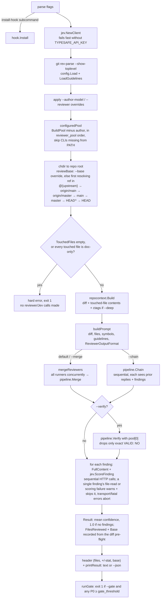

# esuna architecture

How esuna works and why. Structural facts like packages, declarations, and who uses what are generated in [map/REPOMAP.md](map/REPOMAP.md). This doc covers what code can't show on its own: data flow, contracts, invariants, and where to make changes.

> Keep current: run `go run scripts/repomap.go` after structural changes. `go run scripts/repomap.go -check` exits 1 when the generated map is stale. Update this file by hand when flow, contracts, or invariants change.

## What it is

A single Go binary (stdlib only, no module dependencies) that reviews the current Git change. It sends one prompt to several logged-in coding-agent CLIs, parses their line-based findings, deduplicates them, optionally has one reviewer re-check them, then gets a calibrated true-positive probability for each finding from TypeSafe (Jev). Output is human text or a stable JSON contract. `--gate` turns confident P0s into a nonzero exit, which is how the pre-push hook blocks.

## Packages

| Package | Responsibility | Entry points |
|---|---|---|
| `cmd/esuna` | CLI parsing, orchestration, concurrent merge runner, prompt building, output, exit codes, friendly errors | `run`, `installHook` |
| `internal/config` | `.esuna.conf` (strict key=value) and `.esuna/guidelines.md` | `Load`, `LoadGuidelines` |
| `internal/contract` | Output types (`Finding`, `Result`), severity validation, gate rule | `Gated`, `DefaultGateThreshold` (0.7) |
| `internal/repocontext` | Git diff against a base, touched-file contents (root-confined), optional ctags symbol map | `Build`, `FullContent`, `SymbolMap` |
| `internal/reviewer` | The `Runner` interface and one runner per CLI; builds the author-excluded pool | `Runner`, `BuildPool` |
| `internal/pipeline` | Reviewer output format and parser, merge/dedup, sequential chain, verify pass | `ParseReviewerOutput`, `Merge`, `Chain`, `Verify` |
| `internal/jev` | TypeSafe System One client: scores each finding as a "noul" probability | `NewClient`, `(*Client).ScoreFinding` |
| `internal/hook` | Atomic, never-overwrite pre-push hook install | `Install` |

Dependency direction: `contract` is the leaf. `reviewer` and `repocontext` depend on nothing internal. `pipeline` sits on top of those three. `cmd/esuna` wires everything. Nothing imports `cmd`, `jev`, or `hook` except `cmd/esuna`.

## Review run, end to end

Exit codes: `0` success (advisory, even with findings), `1` review error, gate tripped, or an empty/doc-only diff with nothing to review, `2` usage error (bad flags, `--merge` with `--chain`, invalid `--reviewer`).

## Contracts

**Reviewer → esuna (text, one finding per line):** `FILE|LINE|SEVERITY|MESSAGE`. Defined once as `pipeline.ReviewerOutputFormat` and appended to every review prompt. The parser splits on the first three pipes only (messages may contain pipes), requires a local repo-relative path under 255 bytes with no embedded newline/tab/multi-space (added in v1.4, to reject reviewer narration text accidentally glued onto a real path), a positive line, and `P0|P1|P2`. Malformed lines and prose are silently skipped, so parsing never fails.

**Verify reply:** the whole trimmed reply must equal `VALID: NO` to drop a finding. `VALID: YES`, `VALID: UNCLEAR`, and anything ambiguous keep it.

**esuna → TypeSafe:** `POST {baseURL}/v1/systemone`, model `jev-latest`, state `{finding, diff, file_content}`, one noul question `true_positive`. The response must contain exactly one JSON value with a noul in [0,1]. On HTTP 400 `max_tokens_exceeded`, it retries up to three times, halving the diff budget (24 KiB) and the file budget (8 KiB) each time. The finding text itself is never truncated (8 KiB hard limit).

**esuna → user (stable JSON):** `contract.Result{summary, overall_confidence, findings[{file, line, severity, message, confidence}], files_reviewed, base}`. `files_reviewed` and `base` were added in v1.3, after `findings`, to make "reviewed N files, found none" distinguishable from "reviewed nothing" — additive only, the original three keys are unchanged.

## Reviewer CLIs

| Model | Invocation | Prompt delivery |
|---|---|---|
| `claude` | `-p --output-format text --permission-mode plan --permission-prompts none` | stdin |
| `codex` | `--ask-for-approval never exec --sandbox read-only --color never -` | stdin |
| `muse` | `exec --disable-write --approval-mode never --prompt-file <tmp>` | temp file |
| `grok` | `--no-auto-update --permission-mode plan --output-format plain --prompt-file <tmp>` | temp file |

All runners are read-only or plan mode, inherit cwd (the repo root, since `run` chdirs there) and the CLI's existing login, and return raw stdout. Prompts never go on argv, which avoids length limits on large diffs.

## Invariants and deliberate choices

- **No partial success, with one deliberate exception.** In merge mode, any reviewer failure cancels the rest, and the run fails; chain and verify abort on the first error. The one exception is the Jev-scoring loop (v1.4): a single finding's own file-read or scoring failure warns to stderr and drops just that finding, since discarding every finding from a long reviewer run over one bad finding is worse than a partial result. Transport-level and otherwise-unclassified scoring errors still abort the whole run.
- **Scoring is mandatory.** There is no unscored mode, and the TypeSafe key is checked before any Git or CLI work.
- **Author exclusion.** The declared author CLI never reviews its own change. An explicit `--author-model=""` clears a configured author.
- **Deterministic output.** Merge visits models in lexical order. Prompt files are sorted. Symbol JSON relies on sorted map keys.
- **Dedup rule.** A finding is a duplicate when it has the same file, lines within 2 of each other, and one normalized message contains the other. The first location and message are kept, along with the highest severity.
- **Chain disagreement doesn't remove findings.** Only `--verify` can remove one.
- **Path safety.** File reads go through `os.OpenRoot`, so paths and symlinks can't escape the repo. The parser and ctags paths must satisfy `filepath.IsLocal` plus the v1.4 length/character checks.
- **Diff scope.** Staged and unstaged changes against the base are included; untracked files are not. `diffAt` rejects bases starting with `-` and uses `--end-of-options`. The base itself defaults to the first ref that resolves in `@{upstream} → origin/main → origin/master → main → master → HEAD^ → HEAD` (v1.3; previously fell back to `HEAD^` whenever no upstream was tracked, silently reviewing only the last commit on untracked branches) — `--base <ref>` overrides this entirely.
- **Fail loud on nothing to review.** An empty diff, or one where every touched file is a recognized doc file (name/extension allowlist, not directory-based), is a hard error before any reviewer or Jev call — never a misleadingly "clean" `0 findings` result (v1.3).
- **Hook safety.** The hook is written to a private temp file, made executable, then published with `os.Link`, so an existing hook is never overwritten, even under a race. Advisory hooks always `exit 0`.

## Test seams

- `reviewer.Runner` is the injectable boundary for all CLI calls (merge, chain, and verify tests use fakes).
- `cmd/esuna.lookPath` is a package var so PATH probing can be stubbed.
- `jev.Client.baseURL` and `httpClient` are struct fields so tests can point at an `httptest` server.

## Change recipes

**Add a reviewer CLI.** Model validation is duplicated, so touch all of these:
1. `internal/reviewer/reviewer.go`: new `Model` const plus `AllModels`.
2. `internal/reviewer/<name>.go`: runner type with `Model()` and `Review()` (pick stdin or `runPromptFile`).
3. `internal/reviewer/pool.go`: the `BuildPool` switch, runner list, and error text.
4. `internal/config/config.go`: `validModel` and the error messages.
5. `cmd/esuna/main.go`: the `parseReviewerPool` switch, the `--author-model`/`--reviewer` help strings, and `printUsage`.
6. `README.md`, `.esuna.conf.example`, `docs/AGENTS.md.snippet`.

**Add a `.esuna.conf` key:** add a field to `config.Config` and a new `case` in `Load` (unknown keys are rejected, so the key does nothing until it has a case), then wire it in `run`, and document it in the example and README.

**Change the finding format:** `pipeline.ReviewerOutputFormat` and `ParseReviewerOutput` must change together. Also update `text` in `run` (the string sent to TypeSafe) and the `Verify` evidence if new fields matter there.

**Change the gate:** `contract.Gated` (rule) and `contract.DefaultGateThreshold` (default). `runGate` only combines the rule with `--gate`.
