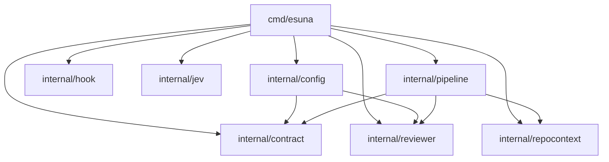

<!-- Code generated by scripts/repomap.go; DO NOT EDIT. Regenerate: go run scripts/repomap.go -->

# esuna repo map (generated)

Structural facts derived from source. For intent, data flow, and invariants see [ARCHITECTURE.md](../ARCHITECTURE.md).

## Package import graph

Production imports only (tests excluded). Arrows point from importer to imported package.

## Packages

| Package | Files | Prod lines | Test lines | Imported by (prod) |
|---|---:|---:|---:|---|
| `cmd/esuna` | 2 | 507 | 815 | — |
| `internal/config` | 3 | 112 | 66 | `cmd/esuna` |
| `internal/contract` | 4 | 39 | 84 | `cmd/esuna`, `internal/config`, `internal/pipeline` |
| `internal/hook` | 2 | 60 | 126 | `cmd/esuna` |
| `internal/jev` | 3 | 154 | 240 | `cmd/esuna` |
| `internal/pipeline` | 6 | 211 | 199 | `cmd/esuna` |
| `internal/repocontext` | 6 | 186 | 203 | `cmd/esuna`, `internal/pipeline` |
| `internal/reviewer` | 7 | 134 | 50 | `cmd/esuna`, `internal/config`, `internal/pipeline` |

## Cross-package symbol usage

Which production files use which symbols from other packages in this module.

- `cmd/esuna/main.go` → `internal/config.Config`, `internal/config.LoadGuidelines`, `internal/config.Load`, `internal/contract.Finding`, `internal/contract.Gated`, `internal/contract.Result`, `internal/hook.Install`, `internal/jev.NewClient`, `internal/pipeline.Chain`, `internal/pipeline.Merge`, `internal/pipeline.ReviewerOutputFormat`, `internal/pipeline.Verify`, `internal/repocontext.Build`, `internal/repocontext.Bundle`, `internal/repocontext.FullContent`, `internal/repocontext.TouchedFiles`, `internal/reviewer.BuildPool`, `internal/reviewer.Claude`, `internal/reviewer.Codex`, `internal/reviewer.Grok`, `internal/reviewer.Model`, `internal/reviewer.Muse`, `internal/reviewer.Runner`
- `internal/config/config.go` → `internal/contract.DefaultGateThreshold`, `internal/reviewer.AllModels`, `internal/reviewer.Claude`, `internal/reviewer.Codex`, `internal/reviewer.Grok`, `internal/reviewer.Model`, `internal/reviewer.Muse`
- `internal/pipeline/chain.go` → `internal/contract.Finding`, `internal/reviewer.Runner`
- `internal/pipeline/merge.go` → `internal/contract.Finding`, `internal/reviewer.Model`
- `internal/pipeline/parse.go` → `internal/contract.Finding`, `internal/contract.ValidSeverity`
- `internal/pipeline/verify.go` → `internal/contract.Finding`, `internal/repocontext.FullContent`, `internal/reviewer.Runner`

## Declarations by file

### `cmd/esuna`

- **`cmd/esuna/main.go`** (507 lines)
  - func `main` — L27
  - func `run` — L29
  - var `lookPath` — L199
  - func `diffStat` — L201
  - func `checkReviewableDiff` — L227
  - func `parseReviewerPool` — L247
  - func `configuredPool` — L267
  - func `reviewBase` — L295
  - func `buildPrompt` — L325
  - type `guidedRunner` — L354
  - method `(guidedRunner).Review` — L359
  - func `mergeReviewers` — L368
  - func `runGate` — L396
  - func `printResult` — L403
  - func `printUsage` — L432
  - func `friendlyError` — L462
  - func `friendlyErrorWithContext` — L466
  - func `installHook` — L486
- tests: `main_test.go`

### `internal/config`

- **`internal/config/config.go`** (92 lines)
  - type `Config` — L18
  - func `Load` — L26
  - func `validModel` — L86
- **`internal/config/guidelines.go`** (20 lines)
  - func `LoadGuidelines` — L11
- tests: `config_test.go`

### `internal/contract`

- **`internal/contract/contract.go`** (25 lines)
  - type `Finding` — L5
  - func `ValidSeverity` — L14
  - type `Result` — L19
- **`internal/contract/gate.go`** (14 lines)
  - const `DefaultGateThreshold` — L4
  - func `Gated` — L7
- tests: `contract_test.go`, `gate_test.go`

### `internal/hook`

- **`internal/hook/install.go`** (60 lines)
  - func `Install` — L16
- tests: `install_test.go`

### `internal/jev`

- **`internal/jev/client.go`** (26 lines)
  - type `Client` — L12
  - func `NewClient` — L20
- **`internal/jev/score.go`** (128 lines)
  - const `diffBudget` — L16
  - const `fileBudget` — L17
  - func `budgetContext` — L22
  - method `(*Client).ScoreFinding` — L43
  - type `scoringError` — L58
  - method `(*scoringError).Error` — L64
  - method `(*Client).scoreFinding` — L68
- tests: `score_test.go`

### `internal/pipeline`

- **`internal/pipeline/chain.go`** (46 lines)
  - func `Chain` — L18
- **`internal/pipeline/merge.go`** (63 lines)
  - func `Merge` — L18
  - func `mergeFindings` — L35
- **`internal/pipeline/parse.go`** (41 lines)
  - const `ReviewerOutputFormat` — L13
  - func `ParseReviewerOutput` — L21
- **`internal/pipeline/verify.go`** (61 lines)
  - func `Verify` — L20
- tests: `merge_test.go`, `parse_test.go`

### `internal/repocontext`

- **`internal/repocontext/content.go`** (29 lines)
  - func `FullContent` — L11
- **`internal/repocontext/context.go`** (33 lines)
  - type `Bundle` — L4
  - func `Build` — L12
- **`internal/repocontext/diff.go`** (50 lines)
  - func `Diff` — L13
  - func `TouchedFiles` — L17
  - func `touchedFilesAt` — L19
  - func `diffAt` — L30
- **`internal/repocontext/symbolmap.go`** (74 lines)
  - type `Symbol` — L14
  - func `SymbolMap` — L22
- tests: `diff_test.go`, `symbolmap_test.go`

### `internal/reviewer`

- **`internal/reviewer/claude.go`** (12 lines)
  - type `claudeRunner` — L5
  - method `(claudeRunner).Model` — L7
  - method `(claudeRunner).Review` — L9
- **`internal/reviewer/codex.go`** (12 lines)
  - type `codexRunner` — L5
  - method `(codexRunner).Model` — L7
  - method `(codexRunner).Review` — L9
- **`internal/reviewer/grok.go`** (12 lines)
  - type `grokRunner` — L5
  - method `(grokRunner).Model` — L7
  - method `(grokRunner).Review` — L9
- **`internal/reviewer/muse.go`** (11 lines)
  - type `museRunner` — L5
  - method `(museRunner).Model` — L7
  - method `(museRunner).Review` — L9
- **`internal/reviewer/pool.go`** (24 lines)
  - func `BuildPool` — L8
- **`internal/reviewer/reviewer.go`** (63 lines)
  - type `Model` — L15
  - const `Claude` — L18
  - const `Codex` — L19
  - const `Muse` — L20
  - const `Grok` — L21
  - var `AllModels` — L24
  - type `Runner` — L27
  - func `runCommand` — L32
  - func `runPromptFile` — L49
- tests: `pool_test.go`

## Exported but unused in production code

Exported identifiers not referenced by any non-test file other than the one declaring them. Candidates for unexporting or deletion; may be intentional test seams. Name-based, so treat as a hint.

- `internal/repocontext.Diff` (func, `internal/repocontext/diff.go` L13)
